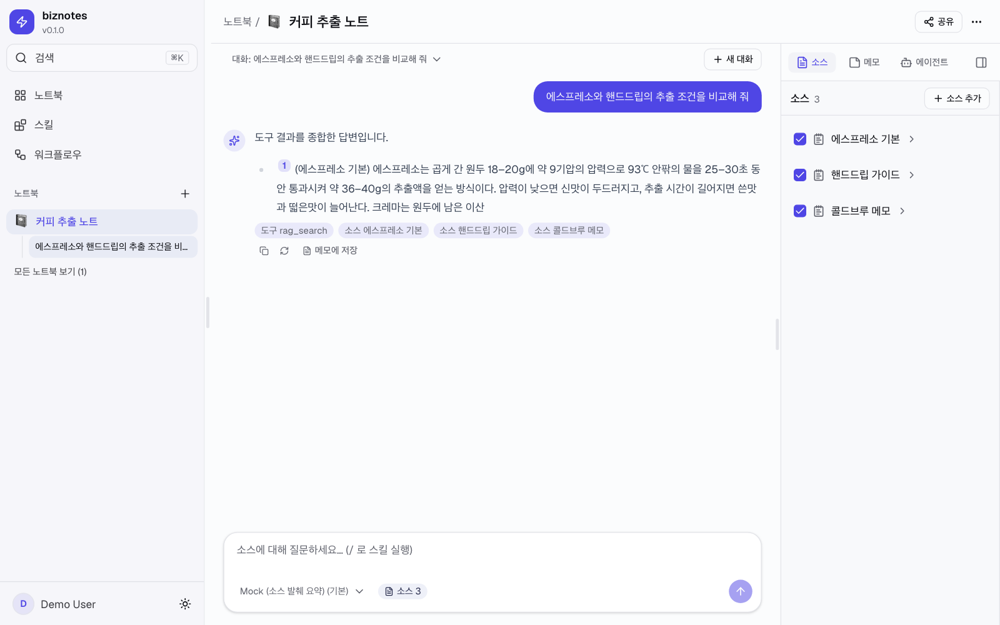
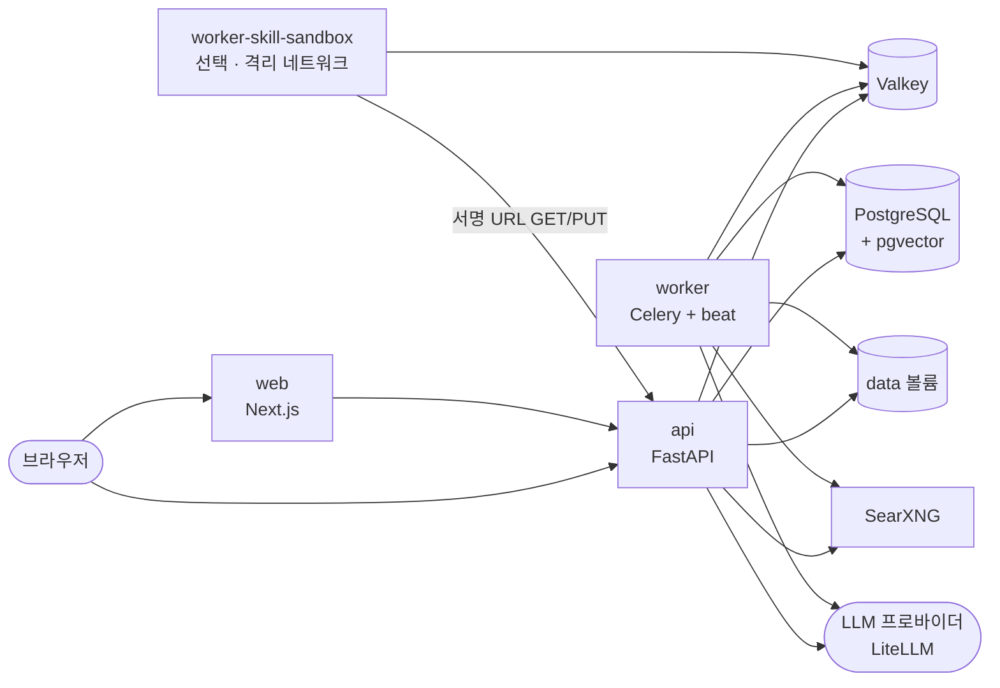

# biznotes

[한국어](#한국어) · [English](#english)



## 한국어

biznotes는 직접 띄워 쓰는 노트북형 RAG 작업 공간입니다. 문서(PDF·Word·PowerPoint·Excel·텍스트·Markdown)와 웹 페이지를 노트북에 모으면, 소스를 근거로 인용 번호가 달린 답을 하는 채팅과 노트, 에이전트·스킬·워크플로 실행, 마인드맵·슬라이드·이미지를 만드는 스튜디오를 한 화면에서 씁니다. 관리자는 사용자, LLM·임베딩 모델, 검색 설정, 사용 한도, 스킬 공개를 웹에서 관리합니다.

가볍게 운영하도록 만들었습니다. `make up` 한 번에 PostgreSQL(pgvector)·Valkey·SearXNG와 api·worker·web이 뜨고, 상태 저장소는 PostgreSQL과 Valkey 둘, 파일은 로컬 볼륨 하나입니다(S3 호환 저장소로 바꿀 수 있습니다). 임베딩은 로컬(fastembed)이라 API 키 없이 색인·검색이 되고, 답변용 LLM은 OpenAI·Anthropic·Google·Ollama·LM Studio 중 원하는 것을 관리 화면에서 연결합니다(LiteLLM). 스킬에 든 스크립트는 네트워크와 파일 접근을 작업마다 허락한 범위로 묶은 별도 샌드박스 워커에서만 돕니다.

biznotes는 두 비공개 저장소의 핵심을 떠내 만든 독립 저장소입니다([ORIGIN.md](ORIGIN.md)). 라이선스는 [Apache-2.0](LICENSE)입니다. 코드 주석과 화면은 한국어입니다.

### 빠른 시작

필요한 것: Docker(Compose v2 포함)와 `make`. 처음 소스를 색인할 때 임베딩 모델(약 240 MB)을 내려받습니다.

```bash
git clone https://github.com/dallisoft/biznotes.git
cd biznotes
make up     # 이미지 빌드 + 기동. api가 시작하면서 DB 마이그레이션을 적용한다
make seed   # 관리자·데모 계정, 샘플 에이전트·스킬 (여러 번 돌려도 같다)
```

<http://localhost:23000>을 열고 시드 계정으로 로그인합니다.

| 계정 | 이메일 | 비밀번호 |
|---|---|---|
| 관리자 | `admin@biznotes.dev` | `admin1234!` |
| 데모 | `demo@biznotes.dev` | `demo1234!` |

시드에는 키 없이 도는 「Mock (소스 발췌 요약)」 모델이 들어 있어 바로 채팅을 해 볼 수 있습니다. 실제 모델은 관리자로 **관리 › LLM**에서 프로바이더를 추가합니다(API 키는 암호화해 저장). 로컬 Ollama·LM Studio는 컨테이너에서 `host.docker.internal`로 닿습니다.

| 주소 | 용도 |
|---|---|
| `localhost:23000` | 웹 |
| `localhost:28000` | API (`/docs`에 OpenAPI) |
| `localhost:28080` | SearXNG |
| `localhost:25433`, `127.0.0.1:26379` | PostgreSQL, Valkey (개발·테스트용) |

자주 쓰는 명령: `make logs s=api`, `make down`(볼륨 유지), `make smoke`(기동 확인), `make help`.

### 설정과 운영

- 설정은 `cp infra/.env.example infra/.env` 뒤 고칩니다. 적지 않은 값은 `infra/compose.yml`의 개발용 기본값을 씁니다.
- `make up`은 개발 오버레이(`infra/compose.dev.yml`: 호스트 포트 노출, api 코드 핫리로드)를 함께 씁니다. 운영에서는 `infra/compose.yml`에 자신의 포트·리버스 프록시 설정을 더해 띄웁니다.
- 운영 전에 반드시: `APP_ENV=prod`, `JWT_SECRET`, `ENCRYPTION_KEY`, `POSTGRES_PASSWORD`를 바꿉니다(`prod`에서 기본값이면 api가 기동을 거부합니다). 시드 계정 비밀번호는 저장소에 공개돼 있으므로 `SEED_ADMIN_PASSWORD`·`SEED_DEMO_PASSWORD`로 바꿔 시드하거나 시드 뒤 바꿉니다.
- 브라우저가 부르는 API 주소는 웹 이미지 빌드 때 들어갑니다. localhost가 아닌 곳에 띄우면 `NEXT_PUBLIC_API_BASE_URL`·`API_BASE_URL`·`WEB_BASE_URL`·`CORS_ORIGINS`를 맞추고 `make build`로 다시 빌드합니다.
- 파일은 기본으로 `data` 볼륨에 저장됩니다. S3 호환 서버(RustFS·SeaweedFS 등)를 쓰려면 `STORAGE_BACKEND=s3`와 `S3_*`를 줍니다(`infra/.env.example`).

### 스킬 스크립트 샌드박스(선택)

스크립트가 든 스킬을 돌리려면 `infra/.env`에 `SKILL_SCRIPT_BACKEND=process`, `SKILL_STANDARD_RUNTIME_ENABLED=true`를 두고 샌드박스 워커를 함께 띄웁니다.

```bash
docker compose -f infra/compose.yml -f infra/compose.dev.yml --profile skill-scripts up -d
```

샌드박스는 `setrlimit → no-new-privileges → Landlock → seccomp`으로 프로세스를 가두고, 데이터 볼륨을 마운트하지 않은 채 api가 발급한 짧은 수명의 서명 URL로만 파일을 주고받습니다. **Linux 커널 6.12 이상, Landlock ABI 6 이상**(`CONFIG_SECURITY_LANDLOCK=y`, 부팅 LSM 목록에 `landlock`)이 필요하고, 컨테이너는 호스트와 같은 아키텍처로 돌려야 합니다. macOS의 Docker Desktop에서도 동작을 확인했습니다. 요건이 맞지 않으면 샌드박스 워커만 기동을 거부하고 나머지 기능은 그대로 씁니다.

### 구조



자세한 흐름(인제스트·하이브리드 검색·에이전트 실행·샌드박스)과 코드 배치는 [docs/ARCHITECTURE.md](docs/ARCHITECTURE.md)에 있습니다. 개발 방법은 [CONTRIBUTING.md](CONTRIBUTING.md), 보안 문제 신고는 [SECURITY.md](SECURITY.md)를 봅니다.

---

## English

biznotes is a self-hosted, notebook-style RAG workspace. Collect documents (PDF, Word, PowerPoint, Excel, text, Markdown) and web pages into a notebook, then use one screen for chat and notes that answer from your sources with numbered citations, for running agents, skills and workflows, and for a studio that produces mind maps, slide decks and images. Administrators manage users, LLM and embedding models, retrieval settings, usage limits and skill publishing from the web UI.

It is built to be light to run. A single `make up` starts PostgreSQL (pgvector), Valkey and SearXNG together with the api, worker and web services. State lives in two stores, PostgreSQL and Valkey, and files in one local volume (an S3-compatible store is optional). Embeddings run locally (fastembed), so indexing and search work without an API key; for answers, connect OpenAI, Anthropic, Google, Ollama or LM Studio in the admin UI (via LiteLLM). Scripts bundled in skills run only in a separate sandbox worker with no network or file access beyond what each job is granted.

biznotes is an independent repository built from the core of two private repositories ([ORIGIN.md](ORIGIN.md)), and is licensed under [Apache-2.0](LICENSE). Code comments and the UI are in Korean.

### Quick start

You need Docker (with Compose v2) and `make`. The first ingestion downloads the embedding models (about 240 MB).

```bash
git clone https://github.com/dallisoft/biznotes.git
cd biznotes
make up     # build images and start; the api applies DB migrations on startup
make seed   # admin and demo accounts, sample agents and skills (idempotent)
```

Open <http://localhost:23000> and sign in with a seeded account: `admin@biznotes.dev` / `admin1234!` (admin) or `demo@biznotes.dev` / `demo1234!`. The seed includes a key-less "Mock" model that answers with source excerpts, so chat works right away. To use a real model, add a provider under **Admin › LLM**. Local Ollama and LM Studio are reached from containers at `host.docker.internal`.

Ports: web `23000`, API `28000` (OpenAPI at `/docs`), SearXNG `28080`, PostgreSQL `25433` and Valkey `127.0.0.1:26379` (for development and tests). Useful commands: `make logs s=api`, `make down` (keeps volumes), `make smoke`, `make help`.

### Configuration and deployment

- Copy `infra/.env.example` to `infra/.env` and edit it. Unset values fall back to the development defaults in `infra/compose.yml`.
- `make up` adds the development overlay (`infra/compose.dev.yml`: host ports, api hot reload). For production, run `infra/compose.yml` with your own ports and reverse proxy.
- Before going to production, set `APP_ENV=prod` and change `JWT_SECRET`, `ENCRYPTION_KEY` and `POSTGRES_PASSWORD` (the api refuses to start in `prod` with defaults). The seed passwords are public, so seed with `SEED_ADMIN_PASSWORD` / `SEED_DEMO_PASSWORD` or change them afterwards.
- The API URL used by the browser is baked into the web image at build time. When hosting somewhere other than localhost, set `NEXT_PUBLIC_API_BASE_URL`, `API_BASE_URL`, `WEB_BASE_URL` and `CORS_ORIGINS`, then rebuild with `make build`.
- Files go to the `data` volume by default. For an S3-compatible server (RustFS, SeaweedFS, …) set `STORAGE_BACKEND=s3` and the `S3_*` variables.

### Skill script sandbox (optional)

To run skills that bundle scripts, set `SKILL_SCRIPT_BACKEND=process` and `SKILL_STANDARD_RUNTIME_ENABLED=true` in `infra/.env` and start the sandbox worker:

```bash
docker compose -f infra/compose.yml -f infra/compose.dev.yml --profile skill-scripts up -d
```

The sandbox confines each script with `setrlimit → no-new-privileges → Landlock → seccomp`, does not mount the data volume, and exchanges files only through short-lived URLs signed by the api. It requires **Linux kernel 6.12 or newer with Landlock ABI 6 or newer** enabled (`CONFIG_SECURITY_LANDLOCK=y`, `landlock` in the boot LSM list), running on the host's native architecture. It also works on Docker Desktop for macOS. If the requirements are not met, only the sandbox worker refuses to start; everything else keeps working.

### Architecture

See the diagram above and [docs/ARCHITECTURE.md](docs/ARCHITECTURE.md) (Korean) for the ingestion, hybrid search, agent and sandbox flows. Development guide: [CONTRIBUTING.md](CONTRIBUTING.md). Security reports: [SECURITY.md](SECURITY.md).
